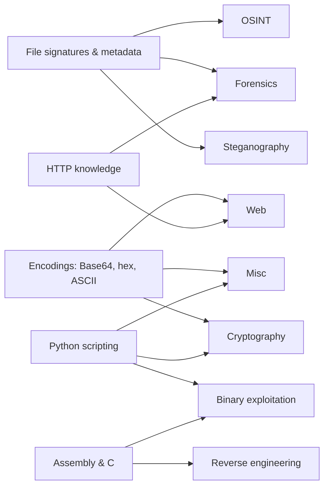

# Categories Overview

[Home](../README.md) › **Categories overview** &nbsp;·&nbsp; Presentation: slide 10 (category map) &nbsp;·&nbsp; Previous: [← CTF fundamentals](CTF_FUNDAMENTALS.md)

Jeopardy CTFs group challenges into categories. This page helps you understand each one at a glance, pick where to start and recognise which category a mystery challenge really belongs to.

---

## The eight categories

| # | Category | In one sentence | You'll typically get | Beginner-friendly? | Slides | Guide |
|---|---|---|---|---|---|---|
| 01 | **OSINT** | Find answers using only public information | An image, a username, a domain | ⭐⭐⭐ Very | 11–12 | [01-OSINT.md](categories/01-OSINT.md) |
| 02 | **Cryptography** | Recover hidden messages from codes and ciphers | A scrambled string or an encryption script | ⭐⭐⭐ Very (classic ciphers) | 13–14 | [02-CRYPTOGRAPHY.md](categories/02-CRYPTOGRAPHY.md) |
| 03 | **Steganography** | Find messages hidden inside innocent files | An image or audio file | ⭐⭐⭐ Very | 15–16 | [03-STEGANOGRAPHY.md](categories/03-STEGANOGRAPHY.md) |
| 04 | **Digital forensics** | Reconstruct what happened from digital evidence | A PCAP, logs, a disk or memory image | ⭐⭐ Yes | 17–18 | [04-DIGITAL-FORENSICS.md](categories/04-DIGITAL-FORENSICS.md) |
| 05 | **Web exploitation** | Find flaws in websites and web apps | A URL (sometimes source code) | ⭐⭐ Yes (with DevTools) | 19–20 | [05-WEB-EXPLOITATION.md](categories/05-WEB-EXPLOITATION.md) |
| 06 | **Reverse engineering** | Work out what a compiled program does | An executable or app | ⭐ Some programming helps | 21–22 | [06-REVERSE-ENGINEERING.md](categories/06-REVERSE-ENGINEERING.md) |
| 07 | **Binary exploitation (pwn)** | Abuse memory bugs to make a program misbehave | A binary, its source, a server port | ⭐ After C and Linux basics | 23–24 | [07-BINARY-EXPLOITATION.md](categories/07-BINARY-EXPLOITATION.md) |
| 08 | **Miscellaneous** | Everything else: programming, puzzles, audio, odd formats | Anything | ⭐⭐⭐ Varies | 25–26 | [08-MISCELLANEOUS.md](categories/08-MISCELLANEOUS.md) |

> Platforms sometimes use other names: **General Skills** (Linux and basics, close to Misc), **Pwn** (binary exploitation), **Cracking** (reverse engineering), **Network** (often forensics), **Programming** (Misc).

---

## Where should I start?

| If you enjoy… | Start with | Then try |
|---|---|---|
| Puzzles, detective stories, geography | [OSINT](categories/01-OSINT.md) | [Forensics](categories/04-DIGITAL-FORENSICS.md) |
| Codes, maths, patterns | [Cryptography](categories/02-CRYPTOGRAPHY.md) | [Misc](categories/08-MISCELLANEOUS.md) |
| Images, design, "spot the difference" | [Steganography](categories/03-STEGANOGRAPHY.md) | [Forensics](categories/04-DIGITAL-FORENSICS.md) |
| Investigating, logs, "what happened?" | [Forensics](categories/04-DIGITAL-FORENSICS.md) | [Web](categories/05-WEB-EXPLOITATION.md) |
| Websites, apps, how the internet works | [Web](categories/05-WEB-EXPLOITATION.md) | [Forensics](categories/04-DIGITAL-FORENSICS.md) (network) |
| Programming, how computers really work | [Reverse engineering](categories/06-REVERSE-ENGINEERING.md) | [Binary exploitation](categories/07-BINARY-EXPLOITATION.md) |
| Coding scripts, lateral thinking | [Misc](categories/08-MISCELLANEOUS.md) | [Cryptography](categories/02-CRYPTOGRAPHY.md) |

**No idea?** OSINT, crypto and steganography need nothing but a browser. Try one challenge in each and follow your curiosity.

---

## Which category is this mystery challenge?

Challenges are sometimes mislabelled or deliberately cross categories. Use the evidence:

| You have… | Think… |
|---|---|
| A photo and a "where/when/who" question | OSINT (check metadata first: stego/forensics overlap) |
| A string of strange characters | Crypto (or Misc if it's an esoteric encoding) |
| An image/audio file with no obvious question | Steganography |
| `.pcap`, `.log`, `.img`, `.raw`, `.mem` | Forensics |
| A URL or a web app | Web |
| An executable and "find the password" | Reverse engineering |
| An executable, its source and `nc host port` | Binary exploitation |
| A server asking questions quickly | Misc (programming) |
| "This file is corrupted" | Forensics/Stego: check the file signature |

---

## Skills that transfer between categories

---

## Shared tools across categories

| Tool | Categories | Guide |
|---|---|---|
| CyberChef | Crypto, Forensics, Misc, Stego | [Browser tools](tools/BROWSER-BASED-TOOLS.md#cyberchef) |
| ExifTool | OSINT, Stego, Forensics | [01 · OSINT](categories/01-OSINT.md#exiftool) |
| `file`, `strings`, `xxd` | Forensics, Stego, RE | [Linux essentials](tools/LINUX-ESSENTIALS.md#3-inspecting-unknown-files) |
| Python | All | [Installable tools](tools/INSTALLABLE-TOOLS.md#python) |
| Ghidra | RE, Pwn | [06 · Reverse engineering](categories/06-REVERSE-ENGINEERING.md#ghidra) |
| Browser DevTools | Web, Misc | [Browser tools](tools/BROWSER-BASED-TOOLS.md#browser-developer-tools) |

---

[← CTF fundamentals](CTF_FUNDAMENTALS.md) &nbsp;|&nbsp; [01 · OSINT →](categories/01-OSINT.md)
